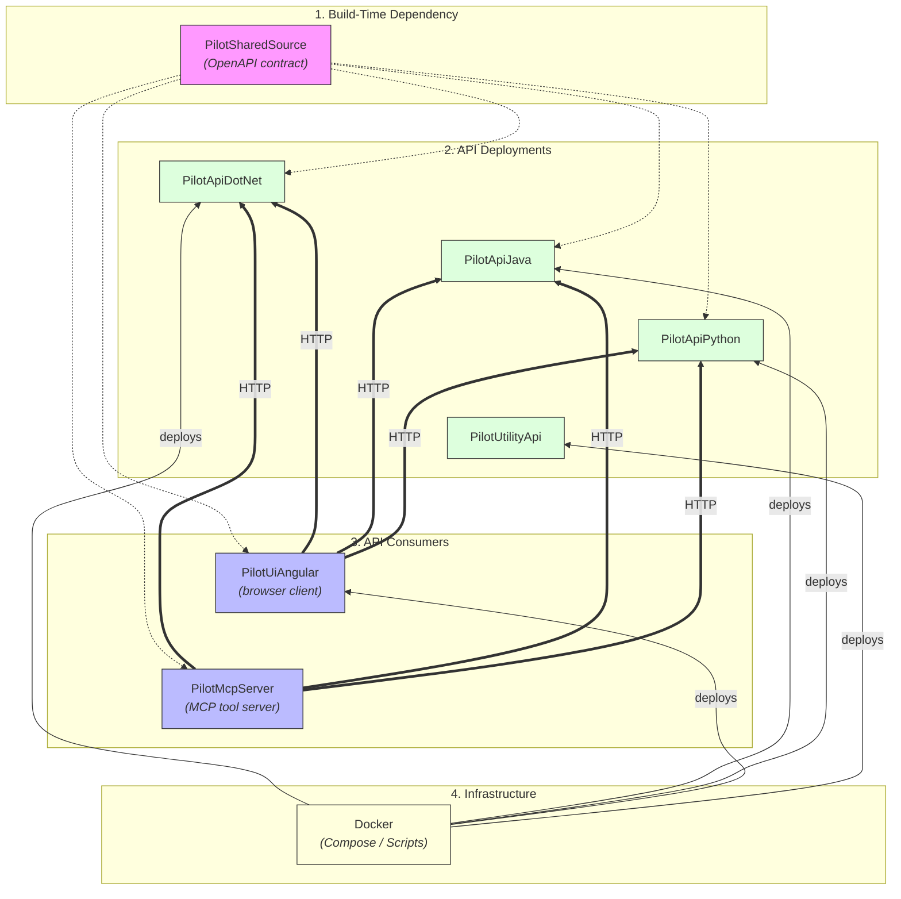

# A-Repository-Guide

A guide to the repositories in this project.

## Repositories

All repositories are owned by [MikeLooper](https://github.com/MikeLooper) on GitHub.

| Repository | Description |
| --- | --- |
| [A-Repository-Guide](https://github.com/MikeLooper/A-Repository-Guide) | This repository. A guide to the other repositories in this project — what each one does and how they fit together. |
| [AIAssistants](https://github.com/MikeLooper/AIAssistants) | AI Assistants to accomplish a multitude of tasks. |
| [AutomationTools](https://github.com/MikeLooper/AutomationTools) | Tools to automate tedious and time consuming tasks. |
| [Docker](https://github.com/MikeLooper/Docker) | The Docker orchestration hub for the project. Holds the Compose files, builder scripts, and secrets templates used to run the databases, the Pilot APIs, the Angular UI, and supporting services (log viewer, uptime monitor, homepage dashboard, observability stack) locally. |
| [PilotApiDotNet](https://github.com/MikeLooper/PilotApiDotNet) | A proof-of-concept .NET Core (C#) REST API that serves Northwind sample data from SQL Server or PostgreSQL, used to explore API best practices (security, OpenTelemetry, configuration). |
| [PilotApiJava](https://github.com/MikeLooper/PilotApiJava) | A proof-of-concept Java Spring Boot REST API that serves the same Northwind data from SQL Server or PostgreSQL, implementing the same API contract as the .NET and Python versions. |
| [PilotApiPython](https://github.com/MikeLooper/PilotApiPython) | A proof-of-concept Python FastAPI REST API that serves the same Northwind data from SQL Server or PostgreSQL, implementing the same API contract as the .NET and Java versions. |
| [PilotMcpServer](https://github.com/MikeLooper/PilotMcpServer) | A C#/.NET Model Context Protocol (MCP) server that exposes all six Pilot API deployments (3 languages × 2 databases) as strongly-typed tools an LLM agent can call over stdio. |
| [PilotSharedSource](https://github.com/MikeLooper/PilotSharedSource) | Shared source (the OpenAPI contract, plus reusable scripts/templates) consumed by the other Pilot repositories as a Git submodule, so the API contract and shared automation stay in one place instead of drifting across repos. |
| [PilotUiAngular](https://github.com/MikeLooper/PilotUiAngular) | A production-style Angular single-page application that consumes the Pilot APIs through an OpenAPI-generated typed client, presenting the Northwind data in a browser UI. |
| [PilotUtilityApi](https://github.com/MikeLooper/PilotUtilityApi) | A .NET Core REST API providing utility operations (such as resetting test data) that support the other Pilot APIs, with the same SQL Server / PostgreSQL switching pattern. |

## Repository Relationships

The diagrams below show how the repositories depend on and call one another. They exclude `A-Repository-Guide`, `AutomationTools`, and `AIAssistants`, which stand apart from the Pilot/Docker system.

Each diagram covers one kind of relationship, so no diagram has more than one arrow style or direction to follow.

**1. Shared OpenAPI contract** — `PilotSharedSource` is pulled in as a Git submodule by every repo that builds against the Pilot API contract:

```
PilotSharedSource  (OpenAPI contract, git submodule)
  ├──> PilotApiDotNet
  ├──> PilotApiJava
  ├──> PilotApiPython
  ├──> PilotUiAngular
  └──> PilotMcpServer
```

**2. Runtime API calls** — at runtime, both consumers call all three Pilot API deployments over HTTP:

```
PilotUiAngular  (browser client)
  ├──HTTP──> PilotApiDotNet
  ├──HTTP──> PilotApiJava
  └──HTTP──> PilotApiPython

PilotMcpServer  (MCP tool server for LLM agents)
  ├──HTTP──> PilotApiDotNet
  ├──HTTP──> PilotApiJava
  └──HTTP──> PilotApiPython
```

**3. Docker deploys** — `Docker` is the only repository that builds and deploys the others:

```
Docker  (Compose files, builder scripts)
  ├──deploys──> PilotApiDotNet
  ├──deploys──> PilotApiJava
  ├──deploys──> PilotApiPython
  ├──deploys──> PilotUiAngular
  └──deploys──> PilotUtilityApi
```

### Combined




Notes:

- **PilotSharedSource** is never deployed itself — it is pulled into `PilotApiDotNet`, `PilotApiJava`, `PilotApiPython`, `PilotUiAngular`, and `PilotMcpServer` as a Git submodule so they all build against the same OpenAPI contract.
- **PilotUiAngular** and **PilotMcpServer** are both API *consumers*: the UI is a browser client for a person, the MCP server is a tool interface for an LLM agent. Both can call any of the three equivalent Pilot API deployments.
- **PilotUtilityApi** is deployed the same way as the Pilot APIs but is not part of the shared-contract/consumer graph — it's a standalone support API (e.g. resetting test data) used alongside the others.
- **Docker** is the only repository that deploys the others; none of the Pilot repositories deploy each other directly.

## Building a Full System

These steps deploy the whole Pilot system, pivoting around the `Docker` repository and its builder scripts. They exclude `A-Repository-Guide`, `AutomationTools`, and `AIAssistants`, which are not part of the deployed system.

### 1. Install prerequisites

- [Docker Desktop](https://docs.docker.com/desktop/setup/install/windows-install/)
- Git (with submodule support)
- Optional, only if you also want to run an API or the UI outside Docker for local development: [.NET 10 SDK](https://dotnet.microsoft.com/download/dotnet/10.0), a JDK + Maven (for `PilotApiJava`), Python 3.12+ (for `PilotApiPython`), Node.js (for `PilotUiAngular`)

### 2. Clone and prepare the `Docker` repository

```
git clone https://github.com/MikeLooper/Docker.git
cd Docker
```

Create the shared network used by every container so they can reach one another by name:

```
docker network inspect pilot-net >nul 2>&1 || docker network create pilot-net
```

Set up runtime secrets: copy each `secrets/*.env.example` file to `secrets/*.env` and fill in real values, per `secrets/README.md`. `*.env` files are git-ignored; `*.env.example` files are the committed templates.

### 3. Deploy a database

Pick SQL Server, PostgreSQL, or both — every Pilot API and `PilotUtilityApi` can run against either.

```
SqlServer\Docker-SQLServer-builder.bat
PostgreSQL\Docker-PostgreSQL-builder.bat
```

### 4. Clone and deploy the three Pilot APIs

For each of `PilotApiDotNet`, `PilotApiJava`, and `PilotApiPython`, clone with submodules so the shared OpenAPI contract (`PilotSharedSource`) comes with it:

```
git clone --recurse-submodules https://github.com/MikeLooper/PilotApiDotNet.git
git clone --recurse-submodules https://github.com/MikeLooper/PilotApiJava.git
git clone --recurse-submodules https://github.com/MikeLooper/PilotApiPython.git
```

Then, from the `Docker` repository, run each API's builder script, choosing the SQL Server or PostgreSQL Compose variant:

```
Api_dotnet\Docker-Api-dotnet-builder.bat
Api_java\Docker-Api-java-builder.bat
Api_python\Docker-Api-python-builder.bat
```

Verify each is up using its Swagger/OpenAPI docs endpoint, for example:

- .NET (SQL Server): `http://localhost:55101/swagger`
- Java (SQL Server): `http://localhost:55301/swagger-ui/index.html`
- Python (SQL Server): `http://localhost:55501/docs`

(PostgreSQL variants of each run on the adjacent port — see the port table below.)

### 5. Clone and deploy `PilotUtilityApi`

```
git clone https://github.com/MikeLooper/PilotUtilityApi.git
```

From the `Docker` repository:

```
Utility_dotnet\Docker-Utility-dornet-builder.bat
```

Verify: `http://localhost:55701/swagger` (SQL Server) or `http://localhost:55801/swagger` (PostgreSQL).

### 6. Clone and deploy `PilotUiAngular`

```
git clone --recurse-submodules https://github.com/MikeLooper/PilotUiAngular.git
```

Point the UI's environment configuration (`src/environments/environment.ts`) at the base URL of whichever deployed API(s) it should call, then, from the `Docker` repository:

```
Ui_angular\Docker-Ui-angular-builder.bat
```

Verify: `http://localhost:55901/`

### 7. (Optional) Run `PilotMcpServer` to expose the APIs to an LLM agent

`PilotMcpServer` is not deployed as a Docker container — it communicates over stdio and is meant to be launched as a subprocess by an MCP-aware client (Claude Desktop, Claude Code, VS Code, etc.), so it runs alongside the Docker-deployed system rather than inside it.

```
git clone --recurse-submodules https://github.com/MikeLooper/PilotMcpServer.git
cd PilotMcpServer
dotnet build
```

Point your MCP client at the built server, for example:

```json
{
  "mcpServers": {
    "pilot": {
      "command": "dotnet",
      "args": ["run", "--project", "C:/path/to/PilotMcpServer/src/PilotMcpServer"]
    }
  }
}
```

It will discover and call whichever of the six Pilot API deployments (3 languages × 2 databases) you selected in the previous steps.

### 8. (Optional) Bring up supporting services

Also from the `Docker` repository, as needed:

```
Dozzle\Docker-Dozzle-builder.bat
Homepage\Docker-Homepage-builder.bat
UptimeKuma\Docker-UptimeKuma-builder.bat
```

### 9. Verify the full system

| Component | URL |
| --- | --- |
| Pilot UI (Angular) | `http://localhost:55901/` |
| Pilot API — .NET (SQL Server / PostgreSQL) | `http://localhost:55101/swagger` / `http://localhost:55201/swagger` |
| Pilot API — Java (SQL Server / PostgreSQL) | `http://localhost:55301/swagger-ui/index.html` / `http://localhost:55401/swagger-ui/index.html` |
| Pilot API — Python (SQL Server / PostgreSQL) | `http://localhost:55501/docs` / `http://localhost:55601/docs` |
| Utility API (SQL Server / PostgreSQL) | `http://localhost:55701/swagger` / `http://localhost:55801/swagger` |
| Dozzle (log viewer) | `http://localhost:56101` |
| Homepage (dashboard) | `http://localhost:56201` |
| Uptime Kuma | `http://localhost:3001` |

For the authoritative, up-to-date port list and Compose/builder-script inventory, see the [Docker repository README](https://github.com/MikeLooper/Docker).
